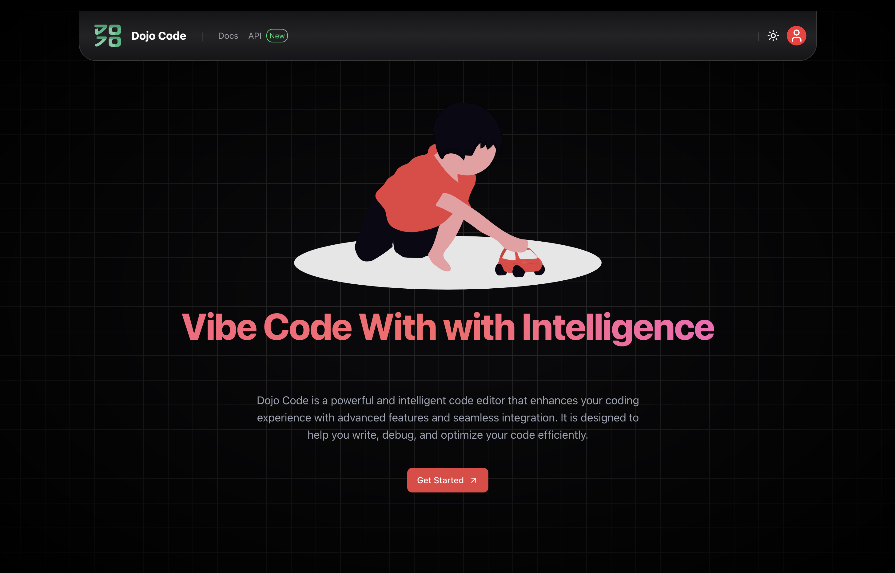
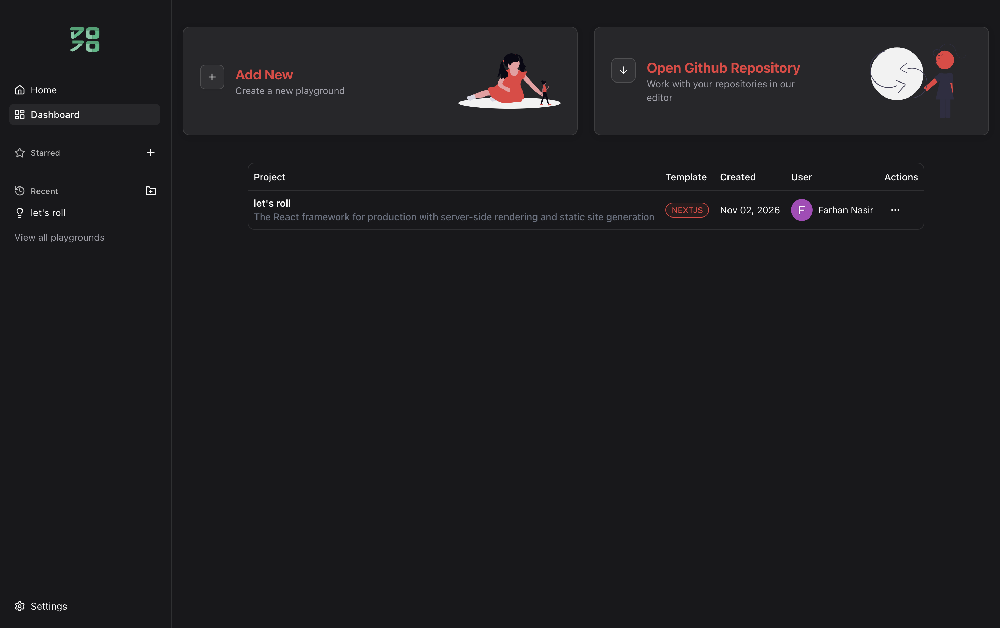
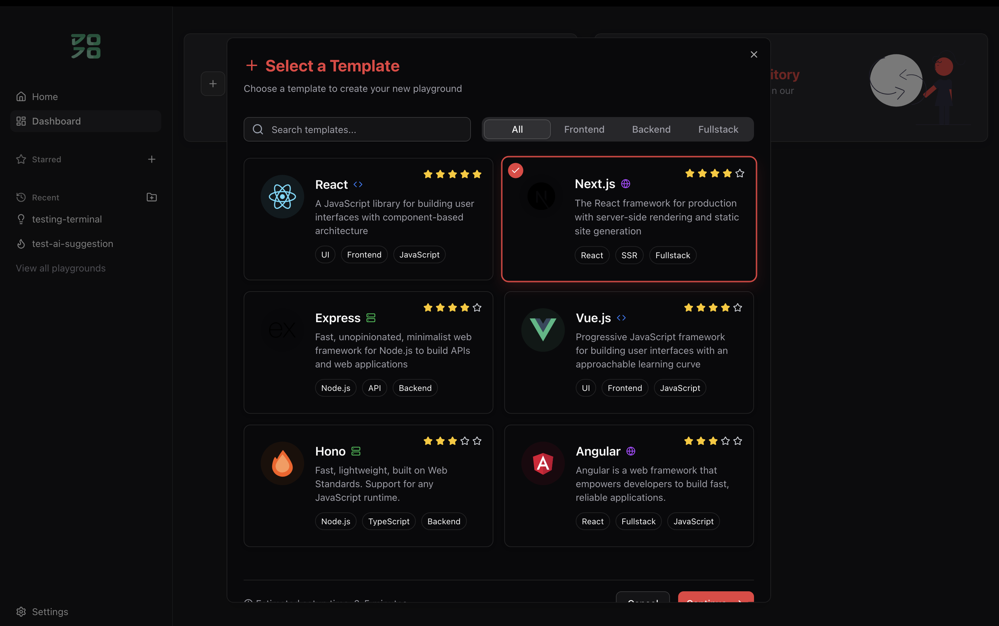
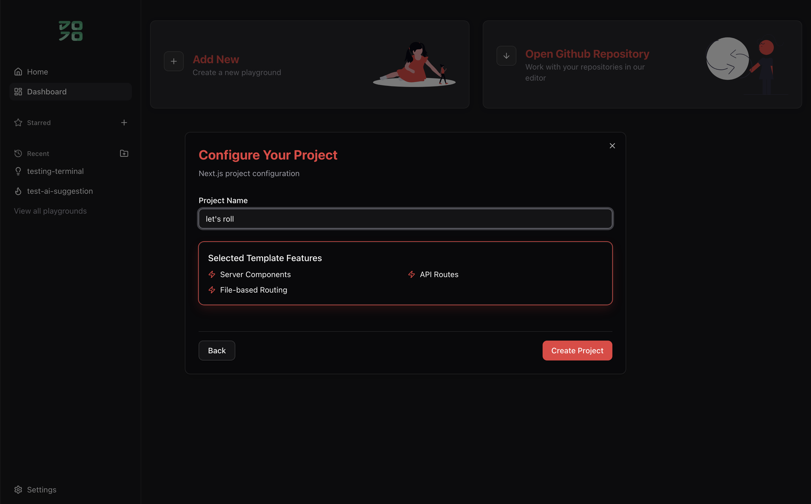
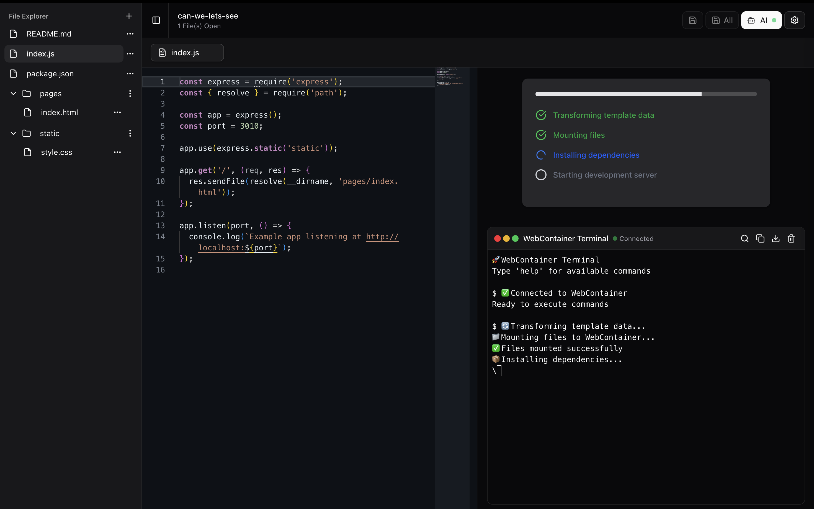
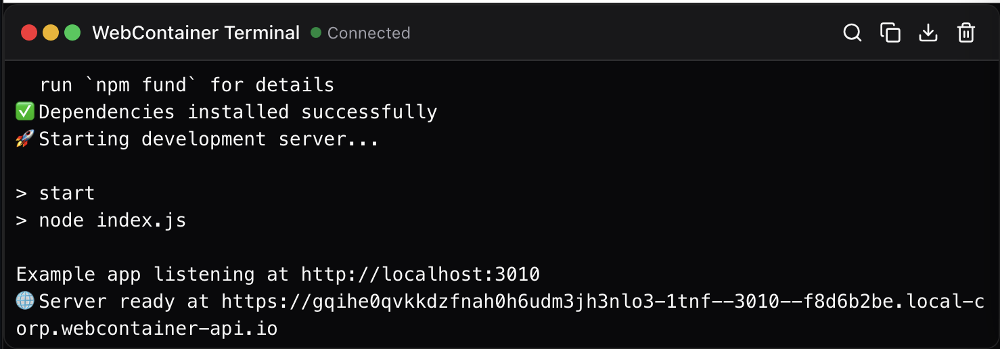
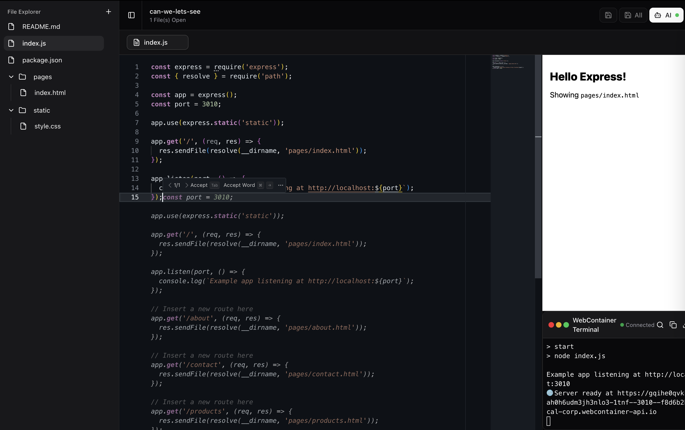
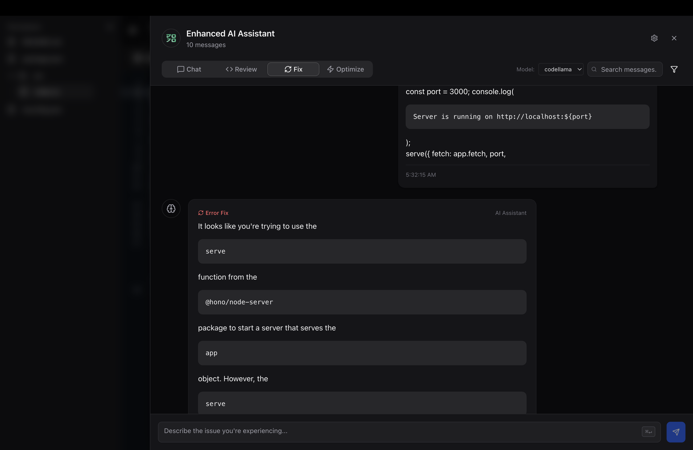
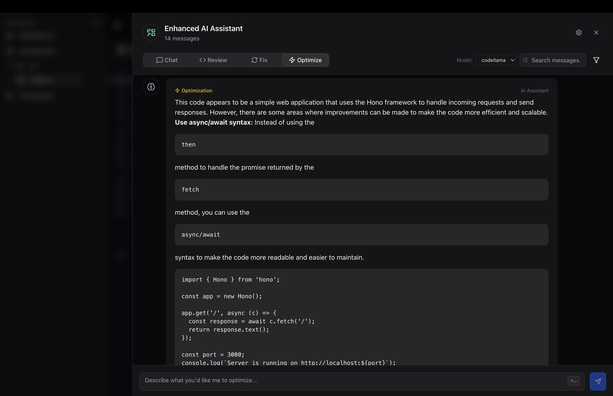
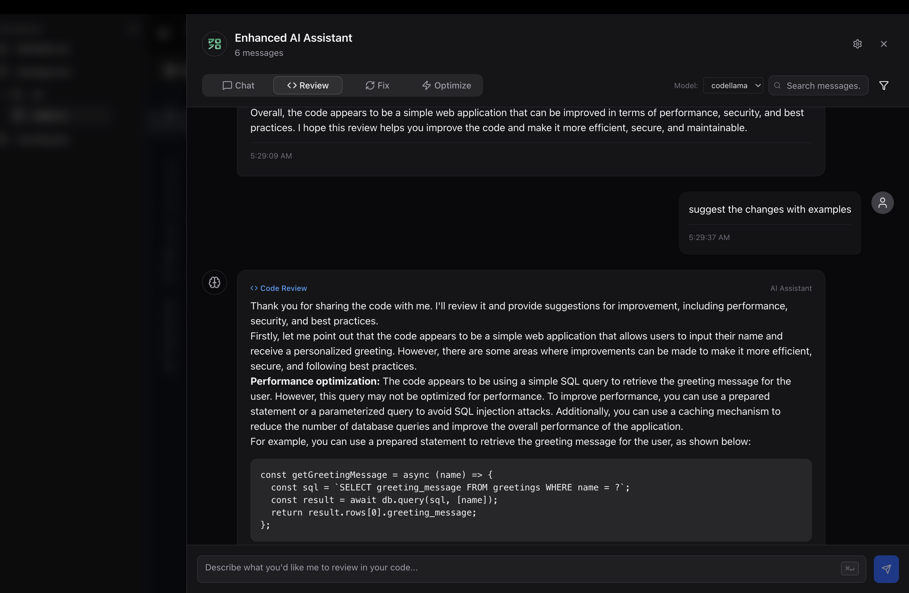

### Landing page



A vibe coding app that runs on the browser on a model that runs locally on your system!! Sounds too good right? Everything is within your browser I'll say just use it once!!

### Home page



### Template selector



### Project name



### Code editor



### Terminal



### Code suggestion



### AI fix



### AI optimize



### AI review




This is a [Next.js](https://nextjs.org) project bootstrapped with [`create-next-app`](https://nextjs.org/docs/app/api-reference/cli/create-next-app).

```bash 
For the first time usage:

Step 1: npm install
Step 2: Get these for your .env 
    DATABASE_URL=mongodb
    NEXTAUTH_URL="http://localhost:3000"
    OLLAMA_URL="http://localhost:11434"
    AUTH_SECRET # Added by ⁠ npx auth ⁠. 
    GOOGLE_CLIENT_ID
    GOOGLE_CLIENT_SECRET
    GITHUB_ID
    GITHUB_SECRET
Step 3: npx prisma generate
Step 4: npx prisma db push

```
Run the development server:

```bash
npm run dev
# or
yarn dev
# or
pnpm dev
# or
bun dev
```

Open [http://localhost:3000](http://localhost:3000) with your browser to see the result.


